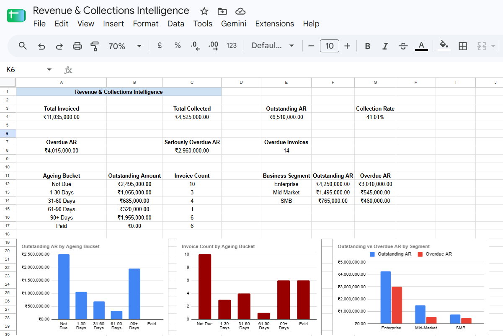

# Revenue & Collections Intelligence Dashboard

## Overview

A revenue operations analytics project built in Google Sheets to monitor accounts receivable (AR), collection performance, overdue invoices, and ageing risk.

The dashboard converts invoice-level data into management KPIs and visual summaries to help prioritise collection efforts and improve receivables visibility.

**Tools:** Google Sheets, Excel (.xlsx), GitHub

**Dataset:** 30 fictional invoice records. No real customer or company data is used.

## Business Problem

Revenue and collections teams need clear visibility into how much has been invoiced, how much cash has been collected, what remains outstanding, and which overdue balances require attention.

This project demonstrates how invoice data can be transformed into a structured reporting dashboard for operational reviews and collection prioritisation.

## Key Performance Indicators

- **Total Invoiced:** Total invoice value.
- **Total Collected:** Total payments recorded against invoices.
- **Outstanding Accounts Receivable:** Invoiced value less collected value.
- **Collection Rate:** Total collected divided by total invoiced.
- **Overdue AR:** Outstanding balances on invoices past their due dates.
- **Seriously Overdue AR:** Outstanding balances more than 30 days past due.
- **Overdue Invoice Count:** Number of outstanding invoices past their due dates.

## Ageing Analysis

Outstanding invoices are grouped into the following categories:

- Not Due
- 1–30 Days Overdue
- 31–60 Days Overdue
- 61–90 Days Overdue
- 90+ Days Overdue

Fully paid invoices are classified separately. This helps distinguish collection workload from the amount of money at risk.

## Dashboard Visualisations

The dashboard includes:

1. KPI summary for invoiced value, collections, outstanding AR, and collection rate.
2. Outstanding AR by ageing bucket.
3. Invoice count by ageing bucket.
4. Outstanding and overdue AR by business segment.

These views help users assess both the financial exposure and the distribution of collection workload.

## Initial Findings

Based on the current fictional dataset and the reporting date used in the workbook:

- Total invoiced value: **₹1,10,35,000**
- Total collected: **₹45,25,000**
- Outstanding AR: **₹65,10,000**
- Collection rate: **41.01%**
- Overdue AR: **₹40,15,000**
- Seriously overdue AR: **₹29,60,000**

The ageing analysis highlights the 90+ day bucket as an area requiring attention. In a real business setting, this would warrant invoice-level validation and follow-up prioritisation before escalation.

## Methodology

1. Imported invoice-level data into Google Sheets.
2. Standardised invoice and due-date values.
3. Calculated outstanding amounts and days overdue.
4. Categorised invoices by ageing and collection status.
5. Built KPI calculations and ageing summaries.
6. Created charts to visualise overdue exposure and segment-level balances.
7. Exported the workbook to Excel for sharing.

## Limitations and Future Improvements

- The dataset is fictional and intended for demonstration.
- The dashboard uses a fixed reporting date for reproducibility.
- Future iterations could use a configurable reporting date, monthly collection trends, customer-level risk scoring, and automated data refreshes.
- SQL-based analysis and workflow automation could be added in a later version.

## Files

- `revenue-collections-dashboard.xlsx` — downloadable workbook containing the dashboard and analysis.
- `dashboard-overview.png` — dashboard preview.
- `revenue_collections_intelligence_dataset.csv` — fictional invoice-level source data used for the analysis.

## Dashboard Preview

## Disclaimer

This project is a portfolio demonstration. The dataset and resulting findings do not represent an actual company's financial performance.
